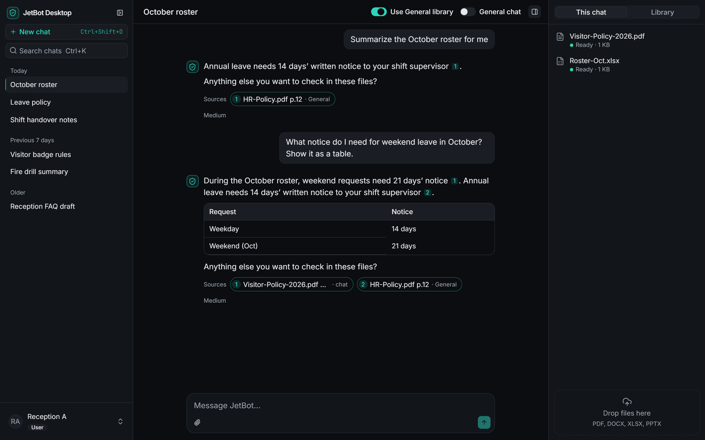
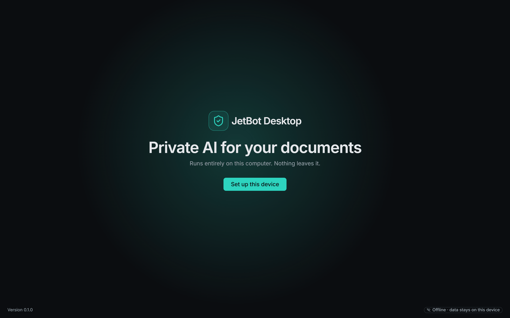
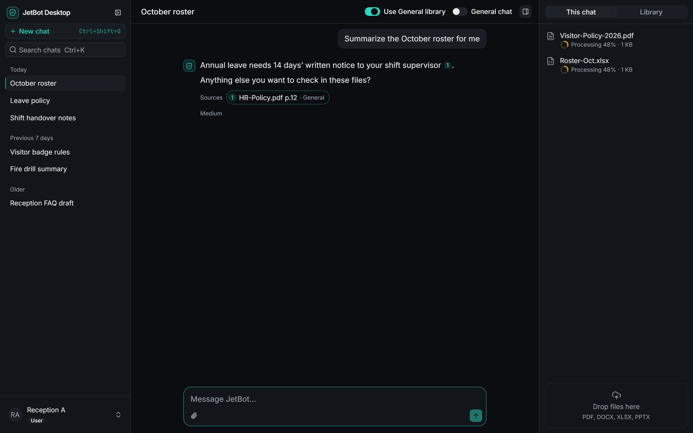
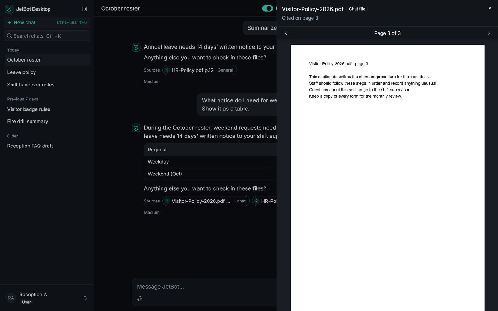
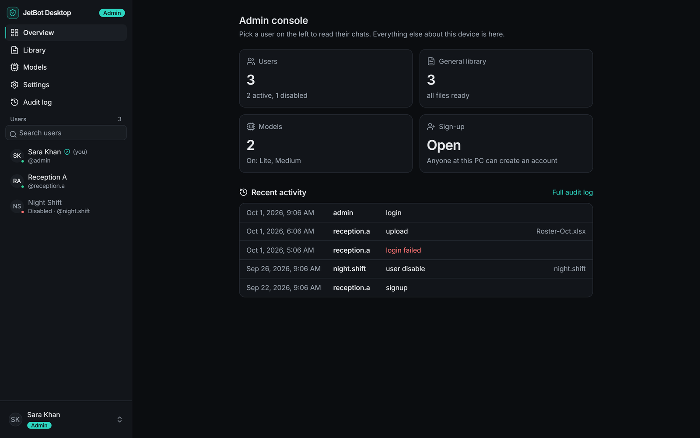
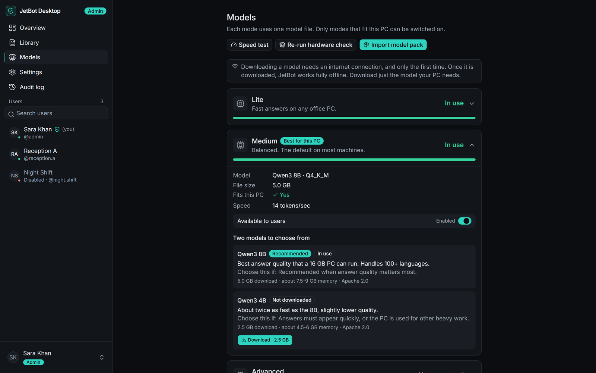
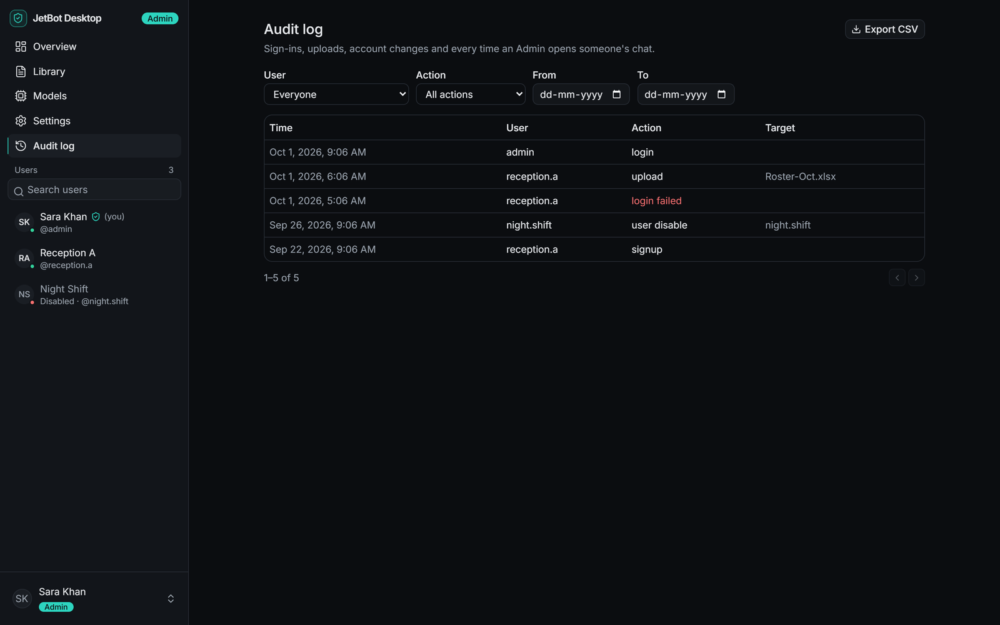

# Private AI Document Assistant (desktop)

An offline Windows app that answers questions from a team's own documents, with citations, and sends nothing to the cloud. I built it during my internship as the lead (and nearly only) developer, from the first prototype to a signed, installable release.

> The source code is private to the company, so this page covers the project, what I built and what I learned. Screenshots use demo data only.

## The problem

Many teams (government, healthcare, legal, finance, industrial sites) can't paste documents into public AI tools, and some sites have no internet at all. This app gives them document Q&A on a PC they already own, with no server, no subscription and no data leaving the machine.

## What it does

- Ask questions of PDF, Word, PowerPoint, Excel, CSV, HTML and text files. Answers cite the file and page, and one click opens the source.
- Runs fully offline: the AI model, the search index and the data all live on the PC.
- Works on shared PCs: private accounts, an Admin console, a shared document library and an audit log.
- Picks a model size to suit the PC's hardware, and installs and updates from a USB stick.

## Screenshots

| | |
|---|---|
|  |  |
|  |  |
|  |  |

## How it's put together

Three parts run together on one machine:

- **Desktop app:** a Tauri (Rust) shell with a React and TypeScript interface. The Rust side starts and watches the other two parts.
- **Local engine:** a Python (FastAPI) service that reads documents, finds the relevant passages and produces answers.
- **AI model runtime:** llama.cpp running a local language model, with a CPU build and a GPU build.

Answering a question follows a standard retrieval-augmented generation (RAG) approach: split the documents into passages, index them locally, find the ones relevant to the question, and have the model answer from them with citations.

## What I built

- **The interface:** chat, file attachment with live indexing status, a source viewer, an Admin console, themes, and automated UI tests.
- **The engine:** document parsing for seven formats, local search, streaming answers, long-chat summarising, and a model switcher that moves between small and large models on demand.
- **Security:** encrypted storage, role-based access enforced on the server side, an audit trail, a locked-down web view, a sandboxed parser for untrusted uploads, and signed and verified components.
- **Release engineering:** a one-command build that produces an offline installer, signed model packs and update packages, with automatic backups before updates.
- **Testing:** more than 300 automated tests, including security tests that check every API route's permissions, and tests on the real installed app.

## What I learned

- **Test where two languages meet.** The Rust launcher and the Python engine pass settings to each other. An empty value turned into the text "None" and sent files to the wrong folder. Only running the real flow end to end caught it, and I fixed it and added a test.
- **Security checks shouldn't break the whole app.** My integrity check first refused to start at all when it met an unknown model. Skipping that one component, logging why, and carrying on was better.
- **Error messages are part of the product.** A screen saying "something went wrong" made a fixable problem look fatal. Showing the real reason made debugging far quicker.
- **Startup speed is a design choice.** Checking and loading large models blocked the window, so I ran the checks alongside startup and loaded the model in the background.
- **Test permissions across the whole API.** Checking every route automatically means a new endpoint that forgets its permission check fails the build.
- **Packaged apps fail differently from dev builds.** Bundling Python needed its own smoke test, because some problems only appear in the packaged version.
- **Offline-first changes everything.** With no update server and no cloud, even updates, licensing and recovery have to be designed differently.

## Tech stack

Rust · Tauri · React · TypeScript · Python · FastAPI · SQLite · llama.cpp · PyInstaller · NSIS · GitHub Actions
